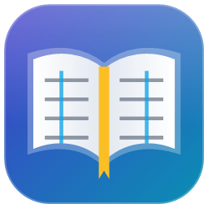
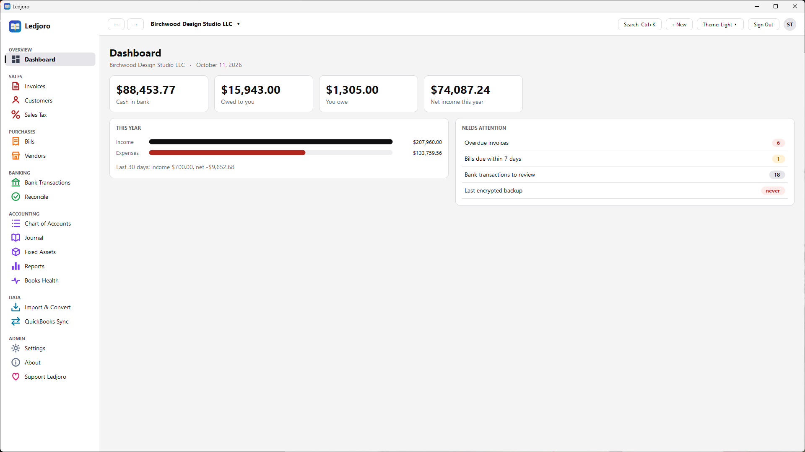
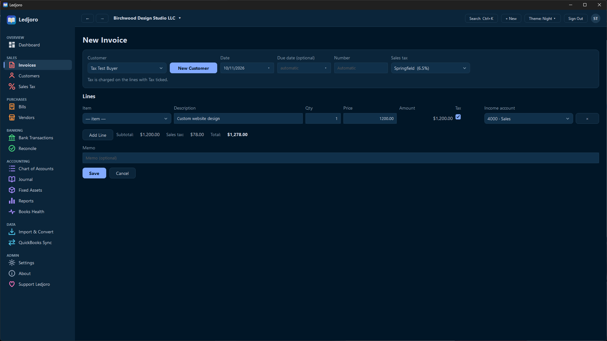
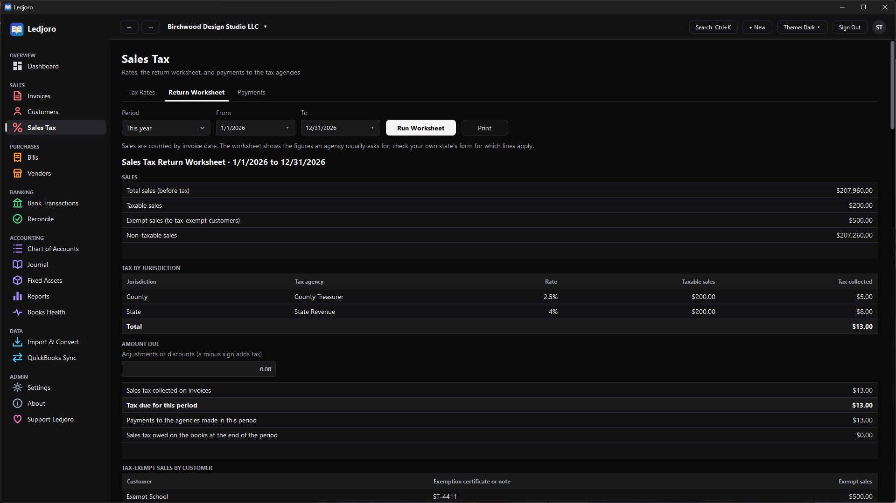
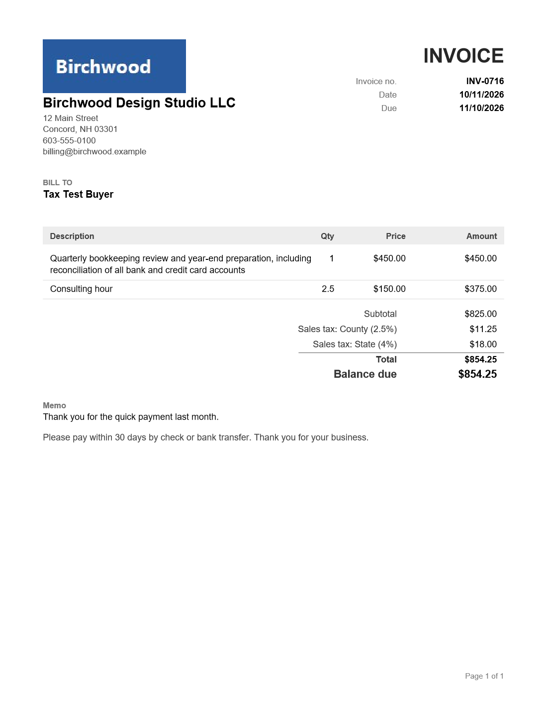
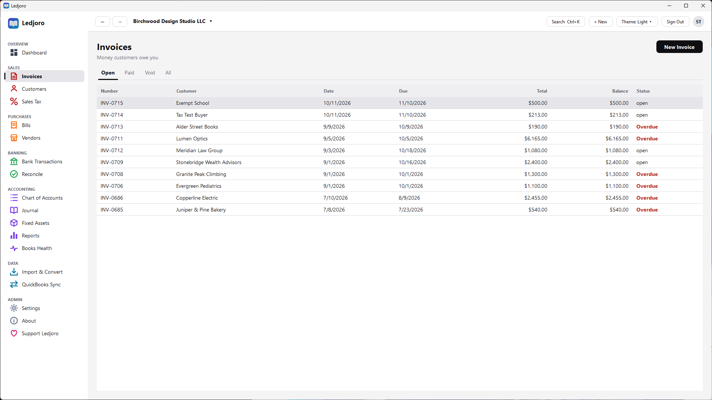
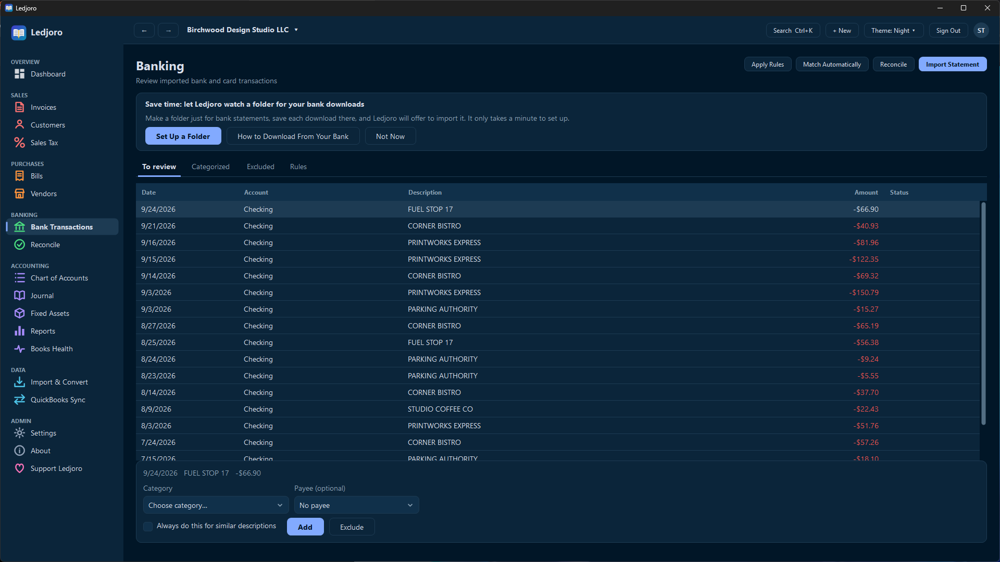
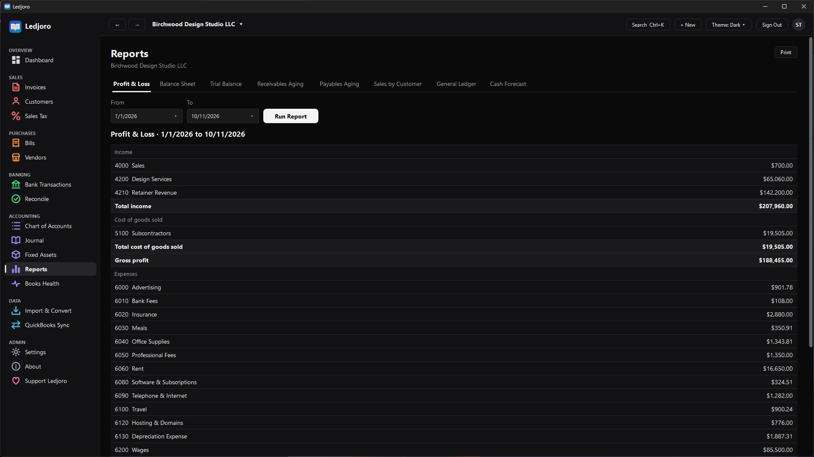
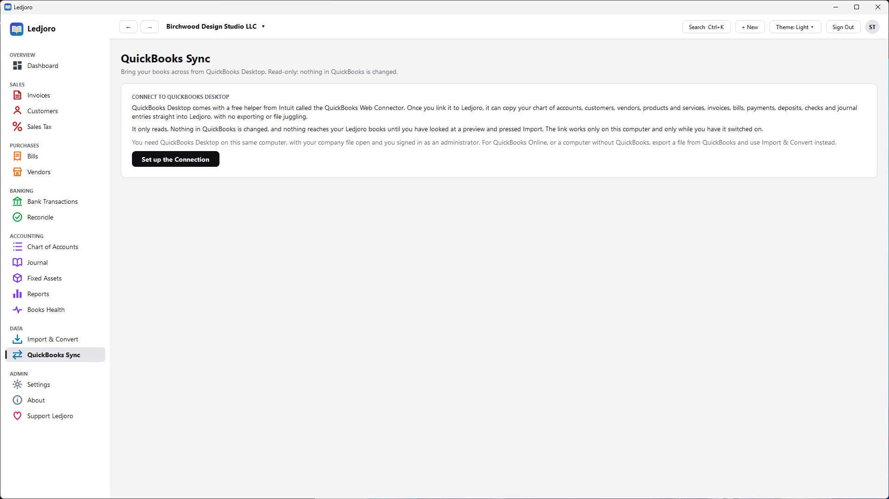
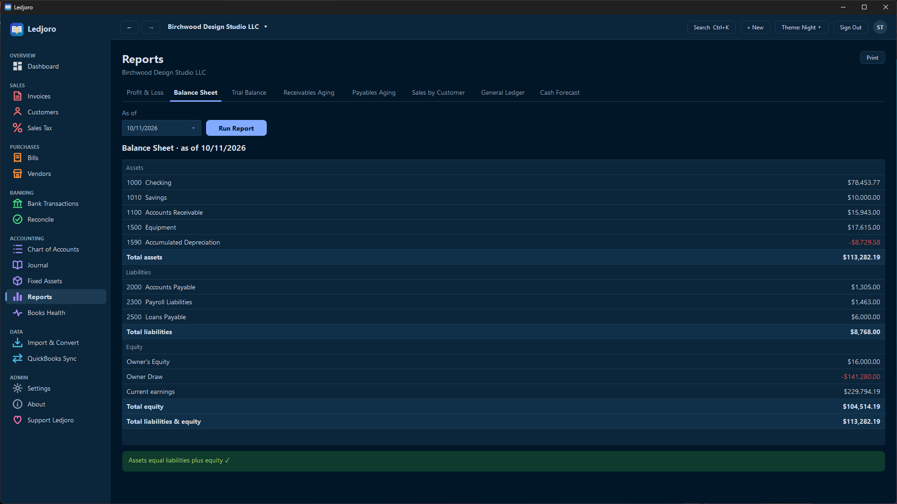

<p align="center"></p>

# Ledjoro

**Free, private accounting for small businesses on Windows.** Invoices, bills, bank reconciliation and reports, with your books kept in a file on your own computer. No account to create, no subscription, nothing sent anywhere.

### [Download Ledjoro for Windows](https://github.com/Tusivo/Ledjoro/releases)

On that page, open the newest release and download **Ledjoro.exe** under **Assets**. There is no installer: you just double-click the file.

> **This is a beta (v0.10.0-beta.1).** It works and has been tested a great deal, but it has not yet been used on many real companies or had an independent security review. Keep your own backups, and have an accountant look over your books before relying on them. See [SECURITY.md](SECURITY.md) and [LEGAL.md](LEGAL.md).


*The dashboard: cash, what you are owed, what you owe, and what needs a look. (Sample company.)*

## Get started in three steps

1. **Download** `Ledjoro.exe` from the [releases page](https://github.com/Tusivo/Ledjoro/releases) and save it in a folder you will remember (for example `C:\Ledjoro`). Ledjoro keeps your books in a folder called `Ledjoro-Data` right beside it, so choose somewhere you can write to, not Program Files.
2. **Double-click it.** Windows may say "Windows protected your PC" because the program is not code-signed yet. Click **More info**, then **Run anyway**.
3. **Create your administrator account.** Then print or save the sign-in sheet it shows: it holds your password and a one-time recovery key, and it is shown only once.

Coming from QuickBooks? Ledjoro can import your lists and transactions (see **Converting from QuickBooks** below) and can pull data straight from QuickBooks Desktop (**QuickBooks Sync**). To update later, open **About** and click **Check for Updates**.

Questions or problems? See [Support the project](#support-the-project) at the end, or use **About, Support** in the program.

## More about how it works

Ledjoro is one native Windows program (no browser, no Chromium, no Electron, no web view) with your data in a local SQLite file and zero npm dependencies. Original design and code; not affiliated with or endorsed by Intuit.

### Good to know

- **First run:** the app opens on a setup screen with the one-time setup token already filled in. Create the administrator, then **print or vault the sign-in sheet** (it shows your password and a one-time recovery key, in red, once).
- **Everything stays beside the program.** Ledjoro writes only to a folder called `Ledjoro-Data` next to `Ledjoro.exe` (the books, settings, logs, and the unpacked engine). Each additional company lives in its own subfolder, `Ledjoro-Data\Companies\<name>`. Nothing goes to your user profile or the registry. To move to another computer, **close Ledjoro and copy `Ledjoro.exe` together with `Ledjoro-Data`** (copy, don't Cut: the folder's permissions belong to your Windows user). Back up and restore from *Settings - Data & backup* (encrypted; one button each).
- **Private by construction:** nothing listens on your network, and there is no telemetry. The only outbound connection is the **Check for Updates** button on the About page, which talks to this project's GitHub releases when you click it (never automatically). The Support and Buy Me a Coffee buttons only open a web page in your browser when clicked. An update is installed only if it carries a signature made with Ledjoro's release key (the matching public key is built into the program; the private key is never on GitHub), so even a tampered GitHub account cannot push a bad update. Your old `Ledjoro.exe` is kept as a backup next to the new one. See [SECURITY.md](SECURITY.md) for how the app and its hidden engine talk to each other.
- **The books file is protected.** While Ledjoro runs it holds the file exclusively (other programs get "database is locked"), the folder's permissions are limited to your Windows user and the system, a read-only flag on the file is cleared automatically (it used to make every sign-in fail with a vague error), and at every start the file is checked for edits made outside Ledjoro, which are reported on screen. See [SECURITY.md](SECURITY.md) for what this can and cannot stop.
- **One copy at a time:** launching it again brings the running window forward.
- **Unsigned:** the exe is not code-signed, so Windows SmartScreen may warn the first time ("More info" then "Run anyway"). Compare `Ledjoro.exe.sha256` with the file, and sign it (Authenticode certificate) if you distribute it to others.
- **Quiet imports.** Importing accounts, vendors and other lists no longer fills the screen with yellow boxes. Yellow is kept for things that need a look (an unbalanced trial balance, rows that could not be read); information, such as accounts left out because they hold no money (QuickBooks "non-posting" accounts), is one grey line with a "Show notes" link.
- **Reconcile** (sidebar, Banking). Pick a bank or card account, type the statement's date and closing balance, click the lines that appear on the statement, and finish when the difference is 0.00. The books refuse to finish until it agrees to the cent. Finished reconciliations are listed, and the newest one per account can be undone. Nothing in the ledger changes; "cleared" is a separate record.
- **Matching.** A bank row that is already in your books (same amount, within ten days) is offered as "Already in your books?" so it is linked instead of being counted twice. "Match automatically" links every row that has exactly one possible entry and leaves the uncertain ones to you. Bank rules can now be removed from the Rules tab.
- **Automatic backups** (Settings, Data & backup). Turn on daily, weekly or monthly backups into a folder you choose (default `Backups` inside the company folder, so it moves with the program, or a USB drive or synced folder). They are locked with your recovery key, or deliberately unlocked; a passphrase is never stored, so it is not offered. Only the newest N automatic backups are kept; backups you save by hand are never touched. While Ledjoro is open it checks every half hour; failures are explained on the page.
- **Search** (Ctrl+K, or the Search button at the top). Finds customers, vendors, invoices and bills (by number, name or amount), accounts, journal entries and pages.
- **Items** (sidebar, Sales). The products and services you sell, each with a usual price, an income account and whether sales tax applies. Choose an item on an invoice and its description, price and account fill in. Items can be changed or made inactive at any time without touching invoices already made.
- **Invoices as PDFs.** *Save as PDF* on any invoice or credit memo makes a clean one-or-more page PDF with your logo, address, phone and email, tax lines, a balance due and a note at the bottom (set under Settings, Company, Printed on invoices). *Email* saves the PDF and opens a new email to the customer in your own mail program, ready for you to attach it. The PDF is built by Ledjoro itself and nothing is uploaded.
- **Copy and correct an invoice.** *Copy* starts a new invoice from an existing one. *Correct* opens it for changes and, when you save, voids the original in the same step (the books keep both, so the history is honest). A paid invoice cannot be corrected until its payments are voided.
- **Credit memos** (sidebar, Sales). Money owed back to a customer: a return, an overcharge or a discount, with sales tax taken back correctly. Apply it to an open invoice of the same customer (in whole or in part), or refund it in cash. Applications and refunds can be undone, and credit memos reduce the sales tax worksheet.
- **Sales Tax** (sidebar, Sales). Add the tax rates you charge (and combined rates such as state plus county, kept separate because each agency wants its own total). On an invoice, choose the rate and tick which lines are taxable: Ledjoro works out the tax per jurisdiction, shows it on the invoice and holds it in Sales Tax Payable until you pay it. Mark a customer as tax-exempt (with a certificate note) and they are never charged. The **Return Worksheet** gives, for any period, total, taxable, exempt and non-taxable sales, the tax collected for each agency, any tax that reached the books another way (a QuickBooks import, a journal entry), your adjustments and the tax due, plus the invoices behind the numbers, ready to print and copy onto your return. **Payments** records what you paid each agency. Sales are counted by invoice date (accrual basis); there is no automatic rate lookup by address, so you choose the rate.
- **QuickBooks Sync** (sidebar, Data). Connects to QuickBooks Desktop through Intuit's free QuickBooks Web Connector, which is installed with QuickBooks Desktop. "Set up the connection" switches on a small link that works only on this computer; you save a connection file (it has no password in it), add it to the Web Connector, type the one-time password Ledjoro shows, and press "Update Selected" there. Ledjoro then reads (never writes) the chart of accounts, customers, vendors, items, invoices, bills, customer and bill payments, deposits, checks, card charges and credits, sales receipts, credit memos, vendor credits, journal entries and transfers, and shows a preview. Nothing reaches your books until you press "Import into my books", and the import appears under Recent imports so it can be undone. Transactions are rebuilt as balanced journal entries tagged with QuickBooks' own transaction ids, so syncing again never imports one twice, and later syncs only ask QuickBooks for what changed. Limits: edits or voids made in QuickBooks after a transaction was imported are not copied; estimates, purchase orders, payroll and inventory adjustments are not brought across; it has been tested against a simulated Web Connector and QuickBooks, not yet against every real company file, so check the preview and your reports after the first import.
- **Watched download folder** (Import & Convert, "Watch a Folder for Bank Downloads"). We recommend a folder just for bank statements: press "Create a Folder for Me" (it makes "Ledjoro Bank Statements" in Documents) or choose your own, and save each bank download there. Ledjoro warns before watching a busy folder such as Downloads or Desktop. "How to Download From Your Bank" opens a window with the general steps and links to the help pages of popular banks (and a web search for the others). Every minute or so, while Ledjoro is open, it looks for new bank statement files there (OFX, QFX and QBO), and lists each one on the Bank Transactions page, on the Dashboard and under the setting: the bank, the account ending, the number of transactions and the dates. Choose the account and press Import; the account is remembered for that bank next time. Files are never moved, changed or deleted, and nothing is imported until you press the button. A file that has been imported or ignored is recognised by its content, so renaming it or downloading it again does not bring it back, while undoing an import makes its file importable again. Only files that arrive after you switch it on are listed (the button "Look at Older Files Too" brings in the newest 50 that were already there). CSV downloads are not picked up automatically because every bank lays them out differently: use Choose File on the same page and match the columns by hand.
- **Command line:** `node src/cli.js` converts files and makes or restores backups without the app (see below).

### What is inside the exe

- **The window** is a native Windows Forms program (.NET Framework 4.8, which ships with Windows 10/11). Every screen is drawn with ordinary Windows controls, themed by the app. There is no HTML, browser engine or web view anywhere.
- **The engine** (ledger, SQLite database, importers, reports) is the same code the tests exercise. It runs as a hidden background process embedded in the exe (Node.js single-executable app), unpacks to `Ledjoro-Data\engine\` on first launch, has its SHA-256 verified on every start, and stops when the app closes. Node.js is a JavaScript runtime, not a browser.
- The only build-time tool that is not part of this repository is `postject` (pinned, not shipped).

## Themes

The **Theme** drop-down in the top-right corner (also on the sign-in screen) offers **Light** (the default), **Dark** (black with gray and white text) and **Night** (deep navy with soft blue, mint and sand accents, inspired by the Night Owl editor theme). The window title bar and scroll bars follow the choice, and it is remembered in `shell.json` in your data folder.

The theme is **Light** until you choose another; the choice is saved in `Ledjoro-Data\shell.json`, and text added to that file by hand does not reset it.

## What it does today

| Area | Features |
|---|---|
| Core ledger | Double-entry journal; integer-cent math (no floating point); immutable posted entries (DB triggers) with reversal-based corrections; closing date |
| Sales | Customers, items, invoices (qty × price, terms, auto numbering), partial payments, void |
| Purchases | Vendors (1099 flag), bills, bill payments, void |
| Banking | Statement import (OFX/QFX/QBO), duplicate-proof, categorize/exclude, match-text rules, “always do this” |
| Accounting | Chart of accounts (editable), manual journal entries, entry reversal |
| Reports | Profit & loss, balance sheet, trial balance, A/R & A/P aging (open-item, works on imported data), sales by customer, general ledger, dashboard; print-friendly |
| Conversion | IIF, OFX/QFX/QBO, qbXML, QBO-API JSON, CSV (accounts, customers, vendors, items, trial balance, account registers), **any other CSV by dragging its columns onto what they mean**, Ledjoro JSON; preview before commit; idempotent re-import |
| Users | Roles with per-permission control (custom roles), forced password change for new users, lockout, audit log, **recovery key** for a lost password, optional **passkey sign-in** (Windows Hello, phone or security key) |
| Data ownership | Full JSON export, CSV exports, **one-click backup** from the app: locked with your recovery key (recommended), with a passphrase of your own (the recovery key opens it too), or not locked at all |

### Beyond the basics - things QuickBooks does not do (or does not do well)
| Feature | What it gives you |
|---|---|
| **Books health check** | A free, explainable review: duplicate invoices/bills, overdrawn accounts, balances on the wrong side, stale bank items, invoice-number gaps, entries dated years ahead, unusually large amounts, missing backups. Every finding says *why it matters* and links to the records. Runs locally; no AI, no data sent anywhere |
| **Undo import** | QuickBooks cannot undo an import. Here every import is a numbered batch; *Undo* posts reversing entries (history stays intact, every period nets to zero) and lets you import the corrected file again |
| **Fixed-asset register** | Straight-line depreciation schedules, one-click "post depreciation through...", disposal with gain/loss, and exact-to-the-cent totals (QuickBooks Online has no fixed-asset manager) |
| **13-week cash forecast** | Built from your own history: open invoices land when *each customer actually pays* (not just the due date), open bills on their due dates, plus recurring payroll/loan/draw patterns. Two scenarios, lowest-cash warning |
| **Backups you cannot get locked out of, and one-button restore** | One file, AES-256, integrity-checked before it is saved. **Your recovery key opens it**, so forgetting a passphrase is never fatal (a passphrase is optional), and you can choose not to lock it. Restore reads the file first, asks only for what it needs, validates it, saves a safety copy of your current data, swaps everything in one atomic step, and signs everyone out. QuickBooks Online has no real backup/restore |
| **Recovery QR code** | The recovery sheet (on screen and printed) carries a QR code. On the sign-in screen, "Forgot your password?" then "Scan the QR code with my camera": hold the code up to the webcam and your username and recovery key fill themselves in; you then choose a new password. Hidden on screen until "Show secrets"; other QR codes the camera sees are ignored; pictures are never saved or sent anywhere |
| **Several companies** | Each company is its own folder with its own books, users, passwords and recovery key, nothing shared. Switch from the company name at the top of the window, or from the sign-in screen; new ones are added in two clicks, and company folders copied in from another computer are found automatically |
| **Errors in plain words** | Every message says what happened, why, and what to do next (no codes, no jargon). A test checks every message the engine can show, and database, disk, permission and connection problems are translated the same way |
| **Tamper-evident audit log** | Hash-chained and append-only; *Verify integrity* proves nobody edited history |
| **Recovery key & printable sign-in sheet** | Save-this-now reminder, a printable sheet, and a one-use key to reset a lost password without e-mail or a vendor account |
| **Themes** | Light (default), Dark and Night from a drop-down in the top-right corner |
| **Text size** | The same drop-down also has Text size: Normal, Medium (15% bigger) or Large (30% bigger). Fonts and spacing grow together. Ledjoro closes and reopens to apply it, and remembers the choice |

See [docs/FEATURE-MAP.md](docs/FEATURE-MAP.md) for what is done, partial, planned, or deliberately out of scope compared with the QuickBooks Online Advanced research.


*Sales tax on an invoice: choose the rate, tick the taxable lines, and Ledjoro adds the tax.*


*The sales tax return worksheet: taxable, exempt and non-taxable sales, tax per agency, and what is due.*


*Save as PDF: an invoice with your logo and address, ready to send.*


*Invoices: who owes you, what is overdue, and what is still open.*


*Bank transactions: import a statement, and Ledjoro offers a category for each line.*


*Reports: profit and loss, balance sheet, trial balance, aging, general ledger and cash forecast.*

## Converting from QuickBooks

**In the app:** *Import & convert* → choose file → *Preview* → *Import now*. Nothing is written until you confirm; re-importing the same file is safe.

**From the command line** (no app or database needed; needs Node.js 24+):
```bash
node src/cli.js formats
node src/cli.js convert samples/sample.iif                          # -> samples/sample.obx.json
node src/cli.js convert tb.csv --format csv-trialbalance --asof 2026-01-01
node src/cli.js convert Personal.CSV --format csv-register --register "Personal Checking"
node src/cli.js convert export.iif --date-order dmy
```

Recommended migration path from QuickBooks:
1. Export the **Chart of Accounts**, **Customer** and **Vendor** lists, and **Products & Services** (CSV, or an IIF list export from Desktop).
2. Export a **Trial Balance** (CSV) as of your cut-over date → imported as one balanced opening-balance entry.
3. For history, export transactions as **IIF** (Desktop) — they convert to balanced journal entries.
4. Import recent **bank statements** (.QBO/.OFX/.QFX) to continue reconciling.

Not supported on purpose: proprietary `.QBW` / `.QBB` company files (undocumented; reverse engineering them is a legal risk — see LEGAL.md).
Tax IDs/SSNs are never imported (data minimisation). Format details: [docs/FORMATS.md](docs/FORMATS.md). Sample files in `samples/` are synthetic.


*QuickBooks Sync: copy your QuickBooks Desktop data across, read-only, after a preview.*


*A balance sheet in the Night theme. Light and Dark are there too.*

## For developers: building from source

You do not need this to use Ledjoro; download the program from the [releases page](https://github.com/Tusivo/Ledjoro/releases). To build it yourself you need Windows, Node.js 24+ and the .NET SDK.

```bash
npm run build          # -> dist/Ledjoro.exe (~90 MB) + dist/Ledjoro.exe.sha256
npm test               # the engine tests
npm run build:engine   # just the engine exe (dist/Ledjoro-Engine.exe)
```

QR codes are made and read by Ledjoro itself (`native/Ledjoro/Qr.cs`, no library). `npm run test:qr` tests the generator and reader (repair, rotation, tilt, blur, noise, smudges), and `scripts/qr-cross-check.py` checks them against independent programs (segno makes codes Ledjoro must read; zxing-cpp must read Ledjoro's codes). Camera scanning needs the Windows SDK at build time (it is skipped without it) and the Windows privacy setting "Let desktop apps access your camera".

The app has its own self-test: `Ledjoro.exe --selftest <folder>` drives every screen and dialog, saves screenshots and writes `result.txt`. Run it against a throwaway data folder (`LEDJORO_DATA`), never your real books. For development, `LEDJORO_ENGINE_JS=src/engine.js` makes the app run the engine from source with `node`.

## For developers: sample data

```bash
npm run demo:seed              # 5 years of history (Oct 2021 - Sep 2026)
node scripts/make-demo-data.js --years 1   # or 1-10 years
```
Generates a fully **synthetic** company, *Birchwood Design Studio LLC* (phones are in the fictional 603-555-01xx range), with a believable trajectory: a thin first year, steady growth to a ~30% margin, customers who join and leave, price and payroll increases, annual equipment purchases with depreciation, a loan that amortizes, seasonal dips, slow payers, quarterly owner distributions, and a recent statement waiting for review. About 1,100 invoices/bills and 1,100 payments over five years. It writes:
- `samples/demo/` - QuickBooks-style files to test the converters (`transactions.iif`, a `.qbo` bank statement, chart/customer/vendor/item CSVs, opening and expected trial balances) - see its `README.md` for the import order;
- `demo-data/ledjoro.db` - a ready-made database with **no users**. Copy it to its own folder, set `LEDJORO_DATA` to that folder before launching `Ledjoro.exe`, then create your own administrator on first launch.

The generator is seeded (reproducible) and self-checking: it loads the same activity natively *and* through the IIF converter and fails unless both trial balances match to the cent.

## Configuration (environment variables)

| Variable | Default | Meaning |
|---|---|---|
| `LEDJORO_DATA` | `Ledjoro-Data` next to the exe (the CLI uses `./data`) | Folder for the database, log and settings |
| `LEDJORO_BACKUP_PASSPHRASE` | — | Passphrase for the CLI `backup`/`restore` (12+ chars) |
| `LEDJORO_ENGINE_JS` | — | Development only: run the engine from this source file instead of the embedded one |

```bash
LEDJORO_BACKUP_PASSPHRASE='…long passphrase…' node src/cli.js backup books.obbak
LEDJORO_BACKUP_PASSPHRASE='…' node src/cli.js restore books.obbak ./restored/ledjoro.db
```

## Layout
```
native/Ledjoro/  the Windows app (C#, WinForms): Shell (window, routing), one file per group of screens, custom-drawn controls (Controls, Inputs, GridView, Dialogs), Theme, Api (talks to the engine), Engine (starts it), SelfTest + Interactions
src/  config, db (schema+triggers+migrations), util (money/validation/phones), ledger, domain, reports, auth, audit, backup, health, fixedassets, forecast, app (JSON API routes), engine (entry point), cli
src/importers/  model, iif, ofx, qbxml (+QBO JSON), csv      src/convert.js  detect → parse → plan → commit, OBX export
scripts/  build-native.js (builds Ledjoro.exe), build-exe.js (engine exe), make-demo-data.js
test/  core.test.js (ledger+converters), http.test.js (auth, CSRF, RBAC, headers, limits, end-to-end), accounts.test.js (phones, recovery key), features.test.js (backup, undo import, assets, health, forecast), restore.test.js
```

## License
AGPL-3.0-or-later (see `LICENSE`): anyone running a modified hosted version must share their changes. Change it before publishing if you prefer MIT/Apache.

## Support the project

Found a problem? Use **About, Support, Report a Problem** in the program, or open an [issue](https://github.com/Tusivo/Ledjoro/issues). Issues are public, so never paste your books or passwords.

Have an idea for a feature? Use **About, Support, Request a Feature**, or email [info@tusivo.com](mailto:info@tusivo.com). Please describe what you want to do and why; do not send your books, account numbers or passwords.

Ledjoro is free and made by one person. If it is useful to you, you can [buy me a coffee](https://buymeacoffee.com/tusivo). Donations change nothing about the program: every feature is there for everyone.
